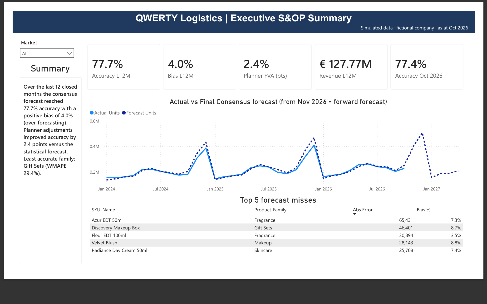
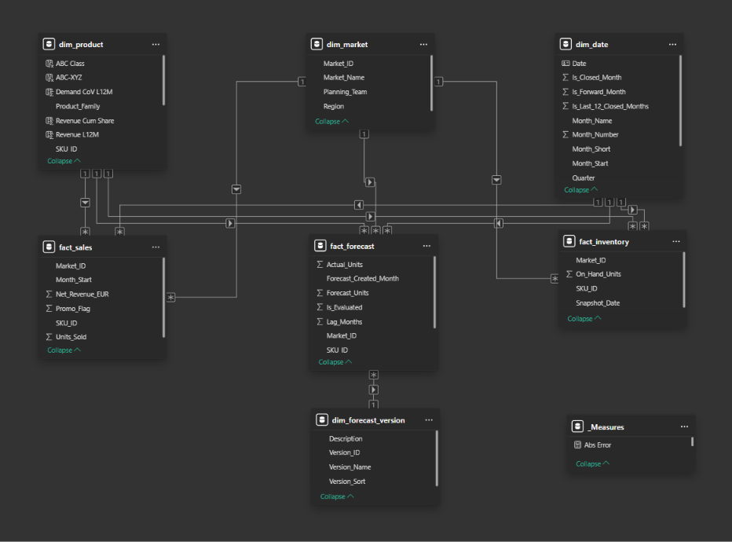
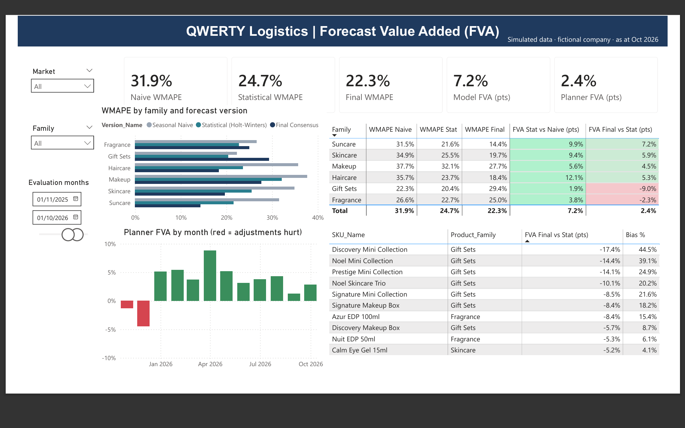
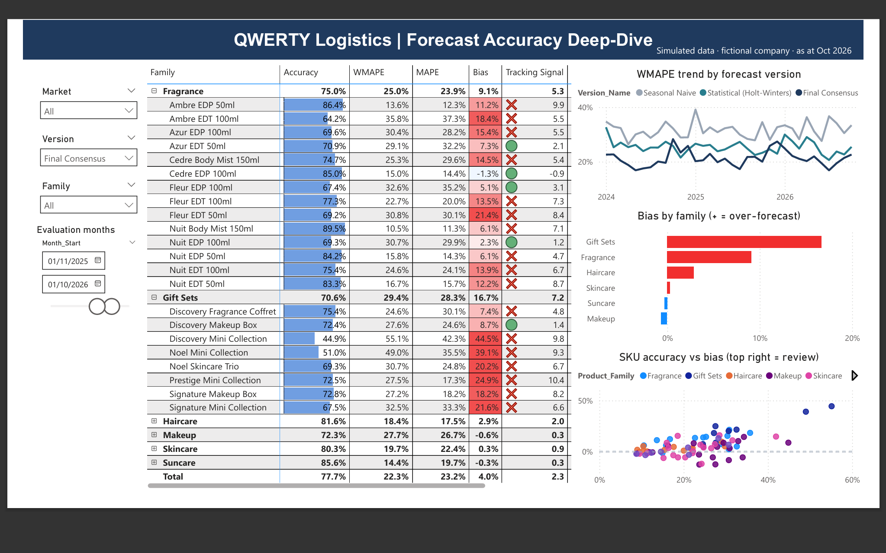
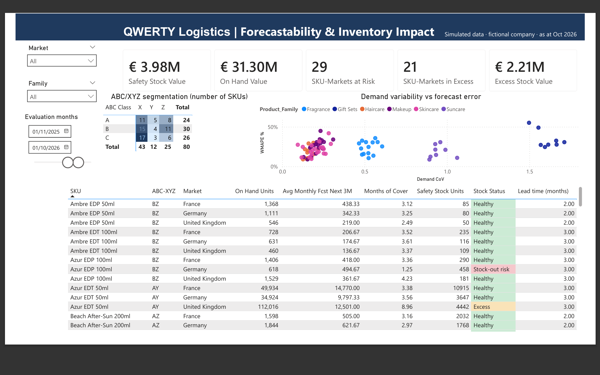
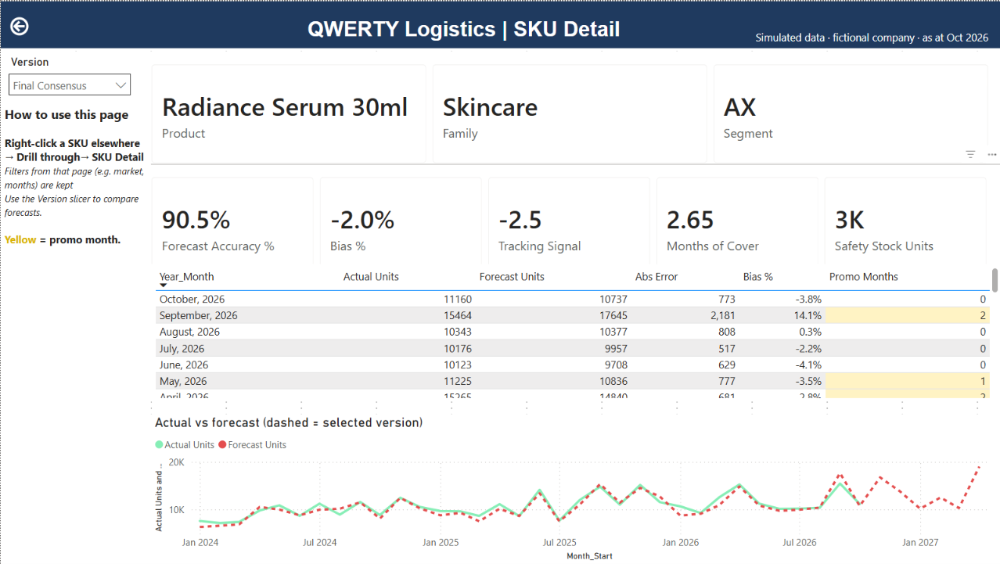

# QWERTY Logistics – Demand Forecast Accuracy & S&OP Dashboard

**Power BI portfolio project · simulated data · author: Akshaynadh Ajithkumar**

A 5-page Power BI report that measures forecast accuracy, bias and **Forecast Value Added (FVA)** across the steps of an S&OP process, and links forecast error to safety stock and stock-out risk.

> **Simulated data.** QWERTY Logistics is a fictional company. All data was generated with the documented Python script in this repository. The project demonstrates the method (data model, KPIs, DAX, S&OP reporting), not real company results.



---

## Business questions

1. How accurate is the forecast, and is it improving?
2. Where is the forecast biased (systematic over- or under-forecasting)?
3. Do the planners' manual adjustments improve the forecast (Forecast Value Added)?
4. Which products are hard to forecast, and what does forecast error cost in safety stock?
5. Which SKU-markets are at risk of a stock-out or carry excess stock today?

The report is "as at" **31 October 2026**. The evaluation window is the **last 12 closed months (Nov 2025 – Oct 2026)**.

## The company and the data

QWERTY Logistics is a fictional distributor of beauty and personal-care products, supplying retailers in **France, Germany and the United Kingdom**: **80 SKUs** in 6 families (Skincare, Makeup, Fragrance, Haircare, Suncare, Gift Sets), with monthly history from **January 2023 to October 2026**.

Three forecast versions, each made **one month ahead (lag 1)**:

| Version | How it is made |
|---|---|
| Seasonal Naive | Same month last year (benchmark) |
| Statistical | Damped Holt-Winters exponential smoothing on promo-cleansed history |
| Final Consensus | Statistical forecast + planner / sales adjustments |

| File | Rows | Grain |
|---|---|---|
| `dim_product.csv` | 80 | one SKU |
| `dim_market.csv` | 3 | one market |
| `dim_date.csv` | 1,826 | one day (2023–2027) |
| `dim_forecast_version.csv` | 3 | one forecast version |
| `fact_sales.csv` | 11,040 | SKU × market × month |
| `fact_forecast.csv` | 28,800 | SKU × market × month × version |
| `fact_inventory.csv` | 240 | SKU × market, snapshot 31 Oct 2026 |

### How the data was simulated
`generator/generate_qwerty_data.py` (Python, pandas + numpy, fixed seed – re-running it gives identical files):

- Demand = base volume × market factor × trend × family seasonality × promotion uplift × noise
- Promotions with a post-promo dip; two events: a SKU going viral (Mar 2026) and a retailer delisting Haircare in Germany (Jul 2025)
- Statistical forecast: Holt-Winters written in numpy, parameters tuned on 2024 only
- Planner adjustments: promo uplift estimates, Q4 sales optimism on Fragrance and Gift Sets, random overrides on some SKUs
- Inventory snapshot built around a "lead time + buffer" stocking policy, with some SKU-markets drifting to risk or excess

## Data model

Star schema: 4 dimensions filtering 3 fact tables (one-to-many, single direction). Actuals are merged into the forecast table in Power Query on a composite key (month, SKU, market), and only lag-1 rows with a known actual are flagged for evaluation.



## KPIs

| KPI | Definition |
|---|---|
| WMAPE | Σ\|forecast − actual\| / Σ actual (errors computed at SKU × market × month level) |
| Forecast accuracy | 1 − WMAPE |
| Bias % | (Σ forecast − Σ actual) / Σ actual; positive = over-forecasting |
| Tracking signal | Cumulative error / mean absolute error, per SKU × market, averaged; outside ±4 = persistent bias |
| FVA (pts) | WMAPE of previous step − WMAPE of next step; positive = the step improved the forecast |
| ABC / XYZ | ABC on 12-month revenue (80 / 15 / 5 %); XYZ on demand coefficient of variation (0.25 / 0.50) |
| Safety stock | z(95%) × σ(forecast error) × √(lead time), per SKU × market |
| Months of cover | On-hand / average monthly forecast of the next 3 months |

All measures and calculated columns are in [`dax/dax_measures.txt`](dax/dax_measures.txt).

## Report pages

| Page | Purpose |
|---|---|
| 1. Executive Summary | Accuracy, bias, planner FVA, revenue; actual vs forecast incl. 6-month forward view; top 5 misses; DAX-generated summary text |
| 2. Accuracy Deep-Dive | Matrix by family → SKU with WMAPE, MAPE, bias, tracking signal; WMAPE trend by version; bias by family; SKU scatter |
| 3. Forecast Value Added | WMAPE at each process step, FVA by family and month, SKUs where adjustments hurt most |
| 4. Forecastability & Inventory | Safety stock, excess and at-risk counts; ABC/XYZ grid; variability vs error; stock position with status |
| 5. SKU Detail (drill-through) | One SKU's KPIs, actual vs forecast and monthly detail with promotion months |






## Key findings (simulated data)

- Final consensus forecast: **77.7% accuracy** (WMAPE 22.3%) with a **+4.0% over-forecasting bias** over the last 12 months.
- The statistical model beats the naive benchmark in every family: **+7.2 points** of WMAPE overall.
- Planner adjustments add **+2.4 points** overall, but **destroy value in Gift Sets (−9.0 pts) and Fragrance (−2.3 pts)**, concentrated in **November–December** – consistent with Q4 sales optimism.
- Gift Sets and Fragrance show a **persistent positive bias** (tracking signal above +4).
- **29 of 240 SKU-markets** are at stock-out risk (cover below supplier lead time) and **21** carry excess; forecast error requires about **€3.98M** of safety stock.

## Skills demonstrated

Power Query (merge on composite key, custom columns) · star-schema modelling · DAX (CALCULATE, iterators, context transition, SELECTEDVALUE, virtual tables) · forecast accuracy and FVA analysis · ABC/XYZ segmentation · safety stock · conditional formatting driven by DAX · drill-through · Python data simulation (Holt-Winters in numpy)

## Repository structure

```
├── README.md
├── QWERTY_Demand_Planning.pbix
├── data/                      7 CSV files
├── data_dictionary.csv
├── generator/generate_qwerty_data.py
├── dax/dax_measures.txt
└── images/                    screenshots
```

## How to use

1. Install Power BI Desktop (free) and open `QWERTY_Demand_Planning.pbix`.
2. If prompted, point the data source to the `data/` folder (Home → Transform data → Data source settings).
3. To regenerate the data: `python generator/generate_qwerty_data.py` (requires pandas and numpy).

## Limitations

Simulated data; monthly buckets; no open purchase orders in the cover calculation; XYZ on demand variability is inflated by seasonality (Suncare, Gift Sets); fixed evaluation window.

---

**Author:** Akshaynadh Ajithkumar – MSc Supply Chain Management, NEOMA Business School · [LinkedIn](https://www.linkedin.com/in/akshaynadh/)
